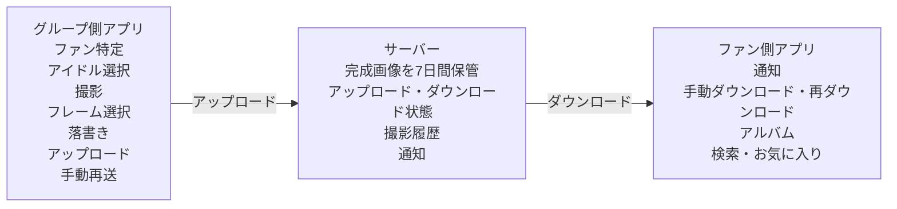
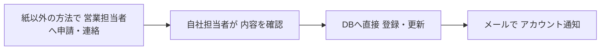
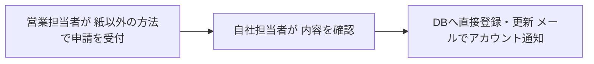
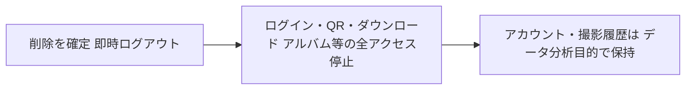
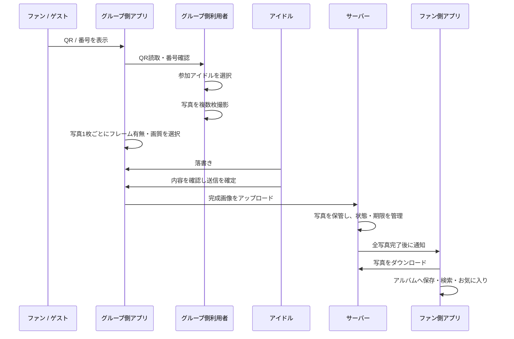
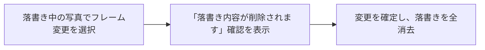
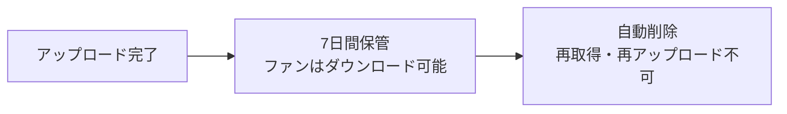
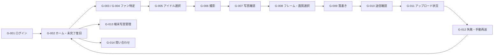
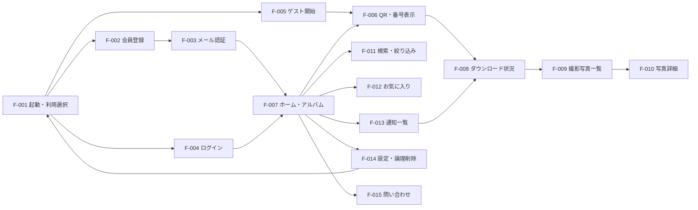

# デジタルチェキアプリ 要求定義書

- 版数：4.1　更新日：2026-07-29　状態：要求定義レビュー用
- 変換元：`要求定義書.xlsx`

## 目次

- 1. 概要
- 2. 対象範囲
- 3. 利用者・アカウント
- 4. 業務フロー
- 5. 機能要件
- 6. 画面一覧
- 7. 画面遷移
- 8. ワイヤーフレーム
- 9. 制約事項
- 10. 未決事項
- 11. 用語集
- 12. 変更履歴

---

# 1. 概要

## 1.1 プロジェクトサマリー
| 項目 | 内容 |
| --- | --- |
| 提供主体 | 自社 |
| 初期対象 | フェーズ1 |
| 写真送受信 | サーバー経由 |
| 写真保管 | アップロード完了から7日 |

## 1.2 サービスの目的
- **1　フィルム代削減**：物理チェキの使用量を抑える
- **2　撮影・配布のデジタル化**：会場での業務を効率化する
- **3　画面を確認**：07〜08 画面遷移・ワイヤーフレーム
- **4　将来のプラットフォーム**：検索・ランキングへ発展

## 1.3 フェーズ構成
| フェーズ | 概要 |
| --- | --- |
| フェーズ1 | 撮影・フレーム・落書き サーバー送信 アルバム・通知 |
| フェーズ2 | フェーズ1の運用で 発生した課題を改善 |
| フェーズ3 | サービス提供者・ アイドル事業者の管理画面 アンケート機能 |
| フェーズ4 | フェーズ3の運用で 発生した課題を改善 |
| フェーズ5 | プラットフォーム 初期構築 |
| フェーズ6 | プラットフォームの 運用改善 |

## 1.4 システム全体像（フェーズ1）

> 写真画像はサーバーへ一時保管します。保存期間は各写真のアップロード完了日時から7日間です。 期限経過後は自動削除し、再ダウンロード・再アップロードには対応しません。

## 1.5 フェーズ1・2の登録運用

> 申請手段、必須情報、登録者・確認者は固定せず、案件や営業担当者の状況に応じて対応します。 登録日時、更新日時、作業者、変更内容などの履歴は残します。

## 1.6 主な確定事項
| 項目 | 決定内容 |
| --- | --- |
| 写真送受信 | Bluetoothは使用せず、サーバー経由でアップロード・ダウンロードする |
| サーバー保管 | アップロード完了から7日間。期限後は自動削除し、再取得・再アップロード不可 |
| 再送 | アップロード・ダウンロードとも自動再実行せず、利用者がボタンを押した場合のみ実行 |
| フレーム | 写真1枚単位で有無を選択。落書き後の変更時は確認後に落書きを全消去 |
| ファン登録 | メールアドレス、ファン名、ログイン用パスワード。ゲスト利用も残す |
| ゲスト | 会員登録後もゲストの写真・撮影履歴を会員へ移行しない |
| アカウント削除 | 論理削除とし、即時ログアウト・全アクセス停止。データは分析目的で保持 |
| フェーズ3以降 | 現段階では大枠のみ定義し、各フェーズ開始時に詳細要求を整理する |

## 1.7 原本のシート構成
| No. | シート | 内容 |
| --- | --- | --- |
| 1 | 01_概要 | 目的、フェーズ、全体構成、主要な決定事項 |
| 2 | 02_対象範囲 | フェーズごとの開発範囲と対象外機能 |
| 3 | 03_利用者・アカウント | 利用者、認証、手動登録、論理削除、管理権限 |
| 4 | 04_業務フロー | 撮影からアップロード・通知・ダウンロードまでの流れ |
| 5 | 05_機能要件 | フェーズ別の機能要件・受入条件 |
| 6 | 06_画面一覧 | フェーズ1の詳細画面と後続フェーズの概要画面 |
| 7 | 07_画面遷移 | フェーズ1のグループ側・ファン側画面遷移 |
| 8 | 08_ワイヤーフレーム | フレーム選択、アップロード、ダウンロード、アルバムの画面イメージ |
| 9 | 09_制約事項 | 保存期限、再送制御、画像、セキュリティ等の制約 |
| 10 | 10_未決事項 | 基本設計・画面設計で決める残課題 |
| 11 | 11_用語集 | 本資料で使用する用語と状態の定義 |
| 12 | 12_変更履歴 | 要求変更と主要な意思決定 |

---

# 2. 対象範囲

## 2.1 フェーズ別の対象範囲
| フェーズ | 目的 | 主な対象 | 詳細度 | 補足 |
| --- | --- | --- | --- | --- |
| フェーズ1 | 初期構築 | 撮影、フレーム選択、落書き、サーバー送受信、アルバム、通知、状態管理、手動再送 | 詳細に要求を定義 | 今回の主要対象 |
| フェーズ2 | 運用改善 | フェーズ1を運用し、発生した不具合・操作性・運用上の課題を修正 | 課題発生時に決定 | 大規模新規機能は原則対象外 |
| フェーズ3 | 管理機能 | サービス提供者側・アイドル事業者側の管理画面、アンケート機能 | 大枠のみ | 詳細はフェーズ開始時 |
| フェーズ4 | 運用改善 | フェーズ3の管理機能を運用し、発生した課題を修正 | 大枠のみ | 詳細はフェーズ開始時 |
| フェーズ5 | プラットフォーム初期構築 | グループ・アイドル検索、プロフィール閲覧、ランキング | 大枠のみ | 詳細はフェーズ開始時 |
| フェーズ6 | プラットフォーム改善 | フェーズ5の運用課題・不具合・表示方法を改善 | 大枠のみ | 詳細はフェーズ開始時 |

## 2.2 フェーズ1の対象機能
| 分類 | 内容 |
| --- | --- |
| グループ側認証 | グループ共通アカウントによるログイン、パスワード変更・再設定 |
| ファン登録・認証 | メールアドレス、ファン名、パスワード、メール認証、ログイン |
| ゲスト利用 | ゲストQR、一時受取番号。会員へのデータ移行は行わない |
| 撮影受付 | QR・会員番号・一時受取番号によるファン特定、参加アイドル選択 |
| 撮影 | ファン1人・アイドル1人以上、複数枚撮影、不採用写真削除 |
| フレーム・編集 | 写真1枚ごとの共通フレーム選択、落書き、フレーム変更時の落書き消去 |
| 画質 | チェキ相当画質・高画質の選択、スマートフォンで一般的な画像形式 |
| アップロード | サーバー経由、状態管理、手動再送、重複防止、3回失敗後の通知 |
| 写真保管 | アップロード完了から7日間、期限後自動削除、再アップロード禁止 |
| ダウンロード | 状態管理、手動再ダウンロード、ファイル受信完了判定、期限後再取得不可 |
| 通知 | 全写真のアップロード完了・ダウンロード可能後に撮影単位で1回通知 |
| アルバム | 新着順、グループ・アイドル・撮影日・お気に入り検索 |
| 復旧 | 撮影・落書き・アップロード状態を端末内へ随時保存し、再起動後に復旧 |
| 論理削除 | ファン削除後は全アクセス停止し、アカウント・履歴データを保持 |
| 問い合わせ | グループ側・ファン側の問い合わせフォーム |

## 2.3 フェーズ1・2では作成しないもの
| 対象外 | 理由・対応フェーズ |
| --- | --- |
| サービス提供者側管理画面 | フェーズ3で実装 |
| アイドル事業者側管理画面 | フェーズ3で実装 |
| アプリ内のグループ・アイドル申請画面 | フェーズ1・2では営業担当者経由＋DB直接登録 |
| アンケート機能 | フェーズ3で大枠を実装 |
| グループ・アイドル検索・ランキング | フェーズ5で実装 |
| 本物のチェキ印刷機能 | 本アプリでは実装せず、他アプリ・外部サービスを利用 |
| 自動アップロード再送 | 手動再送ボタンのみ |
| 自動ダウンロード再実行 | 手動再ダウンロードボタンのみ |
| ゲストから会員への写真・履歴移行 | 対応しない |
| 期限切れ写真の再取得・再アップロード | 対応しない |
| 複数ファン同時撮影 | 初期対象外 |
| 現金・売上・返金管理 | アプリ外の運用 |

## 2.4 フェーズ3の大枠
| 対象 | 機能概要 |
| --- | --- |
| サービス提供者側 | 申請・承認、アカウント発行・停止、アイドル承認、全体送受信状況、エラー・問い合わせ、撮影履歴・集計、アンケート作成・結果閲覧 |
| アイドル事業者側 | グループ情報、アイドル登録・編集申請、卒業・活動状態申請、自グループ送受信状況、撮影履歴・集計、問い合わせ |
| アンケート | サービス提供者のみ作成・回答結果閲覧可能。現段階では機能の大枠のみ定義 |

---

# 3. 利用者・アカウント

## 3.1 利用者と役割
| 利用者 | 主な役割 |
| --- | --- |
| サービス提供者 | フェーズ1・2：DB登録・更新、アカウントメール通知、変更履歴管理。フェーズ3：管理画面で審査・管理 |
| 営業担当者 | 紙以外の任意の手段でグループ・アイドルの申請や変更連絡を受け付ける |
| グループ側利用者 | 撮影受付、撮影、フレーム選択、落書き支援、アップロード、手動再送、端末写真管理 |
| アイドル | 写真への落書き、送信内容の確認・確定 |
| ファン会員 | QR・会員番号提示、写真ダウンロード、アルバム、通知、論理削除 |
| ゲスト | ゲストQR・一時受取番号を使って写真を受け取る。会員へのデータ移行は行わない |

## 3.2 フェーズ1・2のグループ・アイドル登録運用

> メール、フォーム、チャットなどの手段を限定せず、必須資料や登録者・確認者も固定しません。 登録・変更日時、作業者、変更内容などの履歴は保存します。

## 3.3 グループアカウント
| 項目 | ルール |
| --- | --- |
| 発行単位 | 1グループにつき1つの共通アカウント |
| 利用方法 | グループ内の複数人・複数端末で利用可能 |
| 個人アカウント | スタッフ個人・アイドル個人のログインアカウントは作成しない |
| アカウント通知 | 自社担当者がメールで通知する |
| 停止 | 契約終了・規約違反等により利用不可とする |

## 3.4 ファン会員・ゲスト
| 項目 | 仕様 |
| --- | --- |
| 会員登録項目 | メールアドレス、ファン名、ログイン用パスワード |
| メール認証 | 6桁コード、有効期限10分。再送時は旧コードを無効化 |
| ログイン | メールアドレス＋パスワード |
| パスワード条件 | 8文字以上、英大文字・英小文字・数字を含む。記号は任意 |
| 会員特定 | 会員QR。読取不可時は会員番号を使用し、グループ側には存在有無のみ表示 |
| ゲスト | ゲストQR・6桁一時受取番号。後から会員登録しても写真・履歴を移行しない |
| プロフィール情報 | 会員登録時はメールアドレスとファン名のみ。追加属性はフェーズ3のアンケートで収集 |

## 3.5 ファンアカウントの論理削除

> サーバー上の写真は通常どおりアップロード完了から7日後に削除します。 削除済みユーザーは一切アクセスできません。

## 3.6 フェーズ3の管理権限（大枠）
| 機能 | サービス提供者 | アイドル事業者 | 補足 |
| --- | --- | --- | --- |
| グループ申請・承認 | ○ | 申請・確認 | サービス提供者が最終承認 |
| アカウント発行・停止 | ○ | － | サービス提供者のみ |
| アイドル登録・編集 | 承認 | 申請 | アイドル事業者が申請 |
| 写真送受信状況 | 全グループ | 自グループのみ | 端末からの再アップロード操作はグループ側アプリ |
| 問い合わせ | 管理・回答 | 送信・確認 |  |
| 撮影履歴・集計 | 全体 | 自グループのみ |  |
| アンケート作成 | ○ | － | サービス提供者のみ |
| アンケート回答結果閲覧 | ○ | － | アイドル事業者には表示しない |

---

# 4. 業務フロー

## 4.1 通常フロー（フェーズ1）

## 4.2 アップロードの状態と手動再送
| 状態 | 意味 | 利用者操作 |
| --- | --- | --- |
| 未送信 | 送信確定後にアップロード可能 | アップロードボタン |
| 送信中 | サーバーへ送信中 | 進捗表示・削除不可 |
| 送信失敗 | 送信に失敗 | 利用者が手動で再送 |
| 要対応 | 同じ写真で3回連続失敗 | 通知後、再度アップロードボタンを押す |
| アップロード済み | アップロード完了 | 再アップロード不可 |
| 保管期限切れ / 削除済み | アップロード完了から7日経過 | 再アップロード不可 |

## 4.3 ダウンロードの状態と手動再ダウンロード
| 状態 | 意味 | 利用者操作 |
| --- | --- | --- |
| 未受信 | ファンがダウンロード可能な状態 | ダウンロードボタン |
| 受信中 | ファイル受信中 | 進捗表示 |
| 受信失敗 | ダウンロードに失敗 | 利用者が再ダウンロードボタンを押す |
| 受信完了 | 画像ファイルの受信が完了 | アルバムへ表示 |
| 期限切れ | サーバー保管期間が終了 | 再ダウンロード不可 |

## 4.4 フレーム変更と落書きクリア

> 落書きを消去した後に元へ戻す機能は設けません。フレームは写真1枚単位で選択します。

## 4.5 アプリ終了時の復旧
| 中断時の状態 | 端末内に保存する内容 | 復旧後の動作 |
| --- | --- | --- |
| 撮影中 | 撮影セッション・撮影済み写真を端末内へ保存 | 再起動後に撮影済み写真を表示 |
| 落書き中 | 選択フレーム・落書き途中の状態を随時保存 | 再起動後に編集の続きから再開 |
| アップロード待ち / 失敗 | 写真ID・状態・失敗回数を保存 | 再起動後に手動アップロード可能 |
| アップロード済み | アップロード済み状態を保持 | 再起動後も再アップロード不可 |

## 4.6 サーバー保管期間

---

# 5. 機能要件

## 5.1 機能要件サマリー
| フェーズ1・2 | フェーズ3・4 | フェーズ5・6 | 確定 | 要詳細化 |
| --- | --- | --- | --- | --- |
| 53 | 4 | 3 | 59 | 1 |

## 5.2 フェーズ1
| 機能ID | 分類 | 利用者 | 機能名 | 要求内容 | 優先度 | 状態 | 受入条件 | 関連画面 |
| --- | --- | --- | --- | --- | --- | --- | --- | --- |
| P1-AUTH-001 | 認証 | グループ側 | グループログイン | グループ共通アカウントのメールアドレスとパスワードでログインできる | 必須 | 確定 | 正しい認証情報でログインでき、停止済みアカウントではログインできない | G-001 |
| P1-AUTH-002 | 認証 | グループ側 | パスワード再設定 | 登録メールアドレスを使ってパスワードを再設定できる | 必須 | 確定 | 再設定完了後は新パスワードでログインでき、旧パスワードは利用できない | G-002 |
| P1-FAN-001 | ファン会員 | ファン | 会員登録 | メールアドレス、ファン名、ログイン用パスワードで会員登録できる | 必須 | 確定 | 必須項目入力後にメール認証へ進み、認証完了後に会員利用できる | F-002 |
| P1-FAN-002 | ファン会員 | ファン | メール認証 | 6桁コードを発行し、有効期限を10分とする | 必須 | 確定 | 最新コードのみ有効で、期限切れ・旧コードは利用できない | F-003 |
| P1-FAN-003 | ファン会員 | ファン | ファンログイン | メールアドレスとパスワードでログインできる | 必須 | 確定 | 正しい認証情報でログインし、論理削除済みの場合はログインできない | F-004 |
| P1-FAN-004 | ファン会員 | ファン | パスワード条件 | 8文字以上で英大文字・英小文字・数字を含むことを検証する | 必須 | 確定 | 条件を満たさない場合は登録・変更できず、不足条件を表示する | F-002/F-014 |
| P1-GST-001 | ゲスト | ファン | ゲスト利用開始 | 会員登録を行わず、一時ゲストIDで利用開始できる | 必須 | 確定 | ゲストID発行後にゲストQR・一時番号を表示できる | F-005 |
| P1-GST-002 | ゲスト | ファン | ゲストQR・一時番号 | ゲストQRと6桁の一時受取番号を表示する | 必須 | 確定 | どちらの方法でも同じゲストとして特定できる | F-006 |
| P1-GST-003 | ゲスト | システム | ゲストデータ非移行 | ゲスト利用後に会員登録しても、写真・撮影履歴を会員へ移行しない | 必須 | 確定 | 会員登録後もゲストと会員のデータが別のIDとして維持される | - |
| P1-ID-001 | ファン特定 | グループ側 | 会員QR読取 | 会員QRから撮影対象のファンを特定できる | 必須 | 確定 | QR読取成功時に撮影セッションへ会員IDが紐づく | G-003 |
| P1-ID-002 | ファン特定 | グループ側 | 会員番号存在確認 | QR読取不可時に会員番号で存在有無のみ確認できる | 必須 | 確定 | ファン名・メール等を表示せず、存在有無だけを返す | G-004 |
| P1-ID-003 | ファン特定 | グループ側 | ゲスト特定 | ゲストQRまたは6桁一時番号からゲストを特定する | 必須 | 確定 | 撮影セッションへ1人のゲストIDが紐づく | G-003/G-004 |
| P1-SHT-001 | 撮影 | グループ側 | アイドル選択 | 承認済みアイドルを1人以上選択できる | 必須 | 確定 | 0人では撮影へ進めず、複数人を選択できる | G-005 |
| P1-SHT-002 | 撮影 | グループ側 | 複数枚撮影 | 1人のファンに対して複数枚を撮影できる | 必須 | 確定 | 同一撮影セッションに複数写真が保存され、枚数を確認できる | G-006 |
| P1-SHT-003 | 撮影 | グループ側 | 不採用写真削除 | 不採用写真を端末から削除し、送信対象・撮影履歴に含めない | 必須 | 確定 | 削除した写真が送信確認画面と撮影枚数に含まれない | G-007 |
| P1-SHT-004 | 撮影 | グループ側 | 追加撮影 | 専用の撮り直し機能を設けず、通常撮影で写真を追加する | 必須 | 確定 | 追加写真が同一撮影セッションへ保存される | G-006 |
| P1-FRM-001 | フレーム | グループ側/アイドル | 写真単位のフレーム選択 | 写真1枚ごとに共通フレームの有無を選択できる | 必須 | 確定 | 同一撮影セッション内で写真ごとに異なるフレーム設定を保持できる | G-008 |
| P1-FRM-002 | フレーム | グループ側/アイドル | 落書き後のフレーム変更 | 落書き開始後もフレーム変更できるが、確認後に落書きを全消去する | 必須 | 確定 | 確認でキャンセルした場合は変更せず、確定した場合は落書きが消去される | G-008/G-009 |
| P1-FRM-003 | フレーム | システム | 落書き復元不可 | フレーム変更により消去した落書きを元へ戻す機能は設けない | 必須 | 確定 | フレーム変更確定後に元の落書きを復元する操作が表示されない | G-008/G-009 |
| P1-DRW-001 | 落書き | アイドル | 写真への落書き | アイドル本人が写真またはフレームを含む写真へ落書きできる | 必須 | 確定 | 落書き内容が写真単位で保存され、プレビューへ反映される | G-009 |
| P1-DRW-002 | 落書き | アイドル | 複数枚・複数アイドル編集 | 複数枚を切り替えて編集し、複数アイドルが同じ写真へ落書きできる | 必須 | 確定 | 各写真の編集内容を個別に保持できる | G-009 |
| P1-IMG-001 | 画像 | グループ側/アイドル | 完成画像生成 | フレーム選択と落書きを反映した完成画像を生成する | 必須 | 確定 | アップロード対象が落書き後の完成画像のみとなる | G-010 |
| P1-IMG-002 | 画像 | グループ側/アイドル | 画質選択 | チェキ相当画質と高画質を選択できる | 必須 | 確定 | 選択した画質設定で完成画像が生成される | G-010 |
| P1-IMG-003 | 画像 | システム | 一般的な画像形式・圧縮 | スマートフォンで一般的に扱える画像形式と一般的な圧縮設定を使用する | 必須 | 要詳細化 | iPhone・Android双方で保存・表示でき、具体的な形式・数値は基本設計で定義する | - |
| P1-UPL-001 | アップロード | グループ側 | サーバーアップロード | 送信確定後に完成画像をサーバーへアップロードする | 必須 | 確定 | アップロード完了時に写真ID・完了日時・状態が保存される | G-011 |
| P1-UPL-002 | アップロード | システム | 状態管理 | 未送信、送信中、送信失敗、要対応、アップロード済みを写真単位で管理する | 必須 | 確定 | アプリ再起動後も写真ごとの状態が復元される | G-011/G-012 |
| P1-UPL-003 | アップロード | グループ側 | 手動再送 | アップロード失敗後は自動再送せず、利用者の再送操作でのみ再実行する | 必須 | 確定 | 送信失敗写真に再送ボタンが表示され、押下時のみ再実行される | G-012 |
| P1-UPL-004 | アップロード | システム | 3回失敗通知 | 同じ写真が3回連続で失敗した場合に要対応として通知する | 必須 | 確定 | 3回目の失敗時に要対応表示とアップロードボタンが表示される | G-012 |
| P1-UPL-005 | アップロード | システム | 重複アップロード防止 | アップロード済み判定により、同じ写真を再アップロードしない | 必須 | 確定 | アップロード済み写真でアップロード操作ができず、重複データ・重複通知が発生しない | G-011/G-012 |
| P1-UPL-006 | アップロード | サーバー | 7日間保管 | 各写真のアップロード完了日時から7日間サーバーへ保管する | 必須 | 確定 | 期限内はダウンロード可能で、期限経過後に自動削除される | - |
| P1-UPL-007 | アップロード | システム | 期限後の再アップロード禁止 | アップロード済み写真はサーバー削除後も再アップロードできない | 必須 | 確定 | 保管状態が削除済みでもアップロード済み状態が維持される | G-011/G-012 |
| P1-UPL-008 | アップロード | グループ側 | 端末保存・手動削除 | グループ側端末の保存期間を制限せず、利用者が手動削除する | 必須 | 確定 | 利用者が写真を削除でき、アップロード未完了写真は削除できない | G-013 |
| P1-REC-001 | 復旧 | グループ側アプリ | 処理状態の随時保存 | 撮影・落書き・アップロード状態を随時端末内へ保存する | 必須 | 確定 | アプリ強制終了後に未完了セッションを表示できる | G-002/G-007/G-009/G-011 |
| P1-REC-002 | 復旧 | グループ側アプリ | 再起動後の復旧 | 撮影済み写真、フレーム、落書き、アップロード状態を復元し続きから再開する | 必須 | 確定 | 再起動前の未完了状態から操作を継続できる | G-002 |
| P1-DWN-001 | ダウンロード | ファン | 写真ダウンロード | 通知された撮影単位の写真をサーバーからダウンロードできる | 必須 | 確定 | 保管期限内の全写真を受信できる | F-008/F-009 |
| P1-DWN-002 | ダウンロード | ファン側アプリ | 状態管理 | 未受信、受信中、受信失敗、受信完了、期限切れを管理する | 必須 | 確定 | アプリ再起動後もダウンロード状態を確認できる | F-008 |
| P1-DWN-003 | ダウンロード | ファン | 手動再ダウンロード | 失敗後は自動再実行せず、再ダウンロードボタン押下時のみ実行する | 必須 | 確定 | 受信失敗状態でボタンを押した場合のみ再実行される | F-008 |
| P1-DWN-004 | ダウンロード | システム | 受信完了判定 | 画像ファイルの受信が完了した時点を受信完了とする | 必須 | 確定 | ファイル受信完了後にアルバムへ表示される | F-008/F-009 |
| P1-DWN-005 | ダウンロード | システム | 期限後の再取得禁止 | サーバー保管期限経過後は再ダウンロードできない | 必須 | 確定 | 期限切れ状態となり再ダウンロードボタンが利用できない | F-008 |
| P1-NTF-001 | 通知 | サーバー | 通知タイミング | 撮影単位の全写真がアップロード完了し、ダウンロード可能になった時点で1回通知する | 必須 | 確定 | 一部写真が失敗中の場合は通知せず、全写真完了後に1回だけ通知する | F-013 |
| P1-NTF-002 | 通知 | ファン | 通知文 | 単独アイドルでは名前を表示し、複数アイドルでは個別名を表示しない | 必須 | 確定 | 複数撮影時は「複数名のアイドルとのチェキが〇枚届きました」等の共通表現となる | F-013 |
| P1-NTF-003 | 通知 | ファン | 通知遷移・保持 | 通知押下で対象撮影の写真一覧へ遷移し、通知を30日間保持する | 必須 | 確定 | 対象撮影の写真だけが表示され、30日経過後は通知一覧から消える | F-013/F-009 |
| P1-ALB-001 | アルバム | ファン | 写真閲覧 | ダウンロード完了した写真を端末内アルバムで閲覧する | 必須 | 確定 | アプリ再起動後も受信済み写真を表示できる | F-007/F-009/F-010 |
| P1-ALB-002 | アルバム | ファン | 検索・絞り込み | グループ、アイドル、撮影日、お気に入りを複合指定できる | 必須 | 確定 | 指定条件に一致する写真だけが表示される | F-011 |
| P1-ALB-003 | アルバム | ファン | お気に入り | 写真をお気に入り登録・解除できる | 必須 | 確定 | 登録・解除が一覧へ即時反映される | F-010/F-012 |
| P1-ALB-004 | アルバム | ファン | 新着順 | アルバム初期表示を撮影日時の新しい順とする | 必須 | 確定 | 新しい撮影写真が先頭に表示される | F-007 |
| P1-ACC-001 | アカウント | ファン | 論理削除 | アカウントを論理削除し、即時ログアウト・全アクセス停止する | 必須 | 確定 | 削除後はログイン・QR・ダウンロード・アルバム・再設定を利用できない | F-014 |
| P1-ACC-002 | アカウント | サーバー | 削除後データ保持 | 論理削除後もアカウント情報・撮影履歴を分析目的で保持する | 必須 | 確定 | 削除済みユーザーがアクセスできず、管理上は削除済み状態で保持される | - |
| P1-OPR-001 | 運用 | サービス提供者 | DB直接登録・更新 | グループ・アイドル・アカウント情報を自社担当者がDBへ直接登録・更新する | 必須 | 確定 | 登録・変更内容がDBへ反映され、履歴が保存される | - |
| P1-OPR-002 | 運用 | サービス提供者 | 登録・変更履歴 | 登録日時、更新日時、作業者、変更内容を履歴として残す | 必須 | 確定 | 各更新の作業者・日時・変更内容を確認できる | - |
| P1-OPR-003 | 運用 | サービス提供者 | アカウントメール通知 | パスワード・アカウント情報を人力でメール通知する | 必須 | 確定 | 登録完了後に対象事業者へ情報が通知される | - |
| P1-SUP-001 | 問い合わせ | 全利用者 | 問い合わせフォーム | アプリ内フォームから問い合わせできる | 必須 | 確定 | 必須項目入力後に送信でき、受付完了を確認できる | G-014/F-015 |

## 5.3 フェーズ2
| 機能ID | 分類 | 利用者 | 機能名 | 要求内容 | 優先度 | 状態 | 受入条件 | 関連画面 |
| --- | --- | --- | --- | --- | --- | --- | --- | --- |
| P2-IMP-001 | 運用改善 | 全体 | フェーズ1課題改善 | 実運用で発生した不具合・操作性・運用課題を修正する | 必須 | 確定 | 課題一覧に基づき優先度を決め、修正結果を検証する | - |

## 5.4 フェーズ3
| 機能ID | 分類 | 利用者 | 機能名 | 要求内容 | 優先度 | 状態 | 受入条件 | 関連画面 |
| --- | --- | --- | --- | --- | --- | --- | --- | --- |
| P3-ADM-001 | 管理画面 | サービス提供者 | サービス提供者管理画面 | 申請・承認、アカウント発行・停止、アイドル承認、送受信状況、問い合わせ、履歴・集計を管理する | 概要 | 確定 | フェーズ3開始時に詳細要求を再定義する | A-001〜A-007 |
| P3-BIZ-001 | 管理画面 | アイドル事業者 | アイドル事業者管理画面 | グループ情報、アイドル登録・編集申請、自グループ送受信状況、履歴・集計、問い合わせを管理する | 概要 | 確定 | フェーズ3開始時に詳細要求を再定義する | I-001〜I-005 |
| P3-SUR-001 | アンケート | サービス提供者 | アンケート管理 | サービス提供者がアンケートを作成・管理し、回答結果を閲覧する | 概要 | 確定 | アイドル事業者には作成・回答結果閲覧権限を与えない | A-008 |

## 5.5 フェーズ4
| 機能ID | 分類 | 利用者 | 機能名 | 要求内容 | 優先度 | 状態 | 受入条件 | 関連画面 |
| --- | --- | --- | --- | --- | --- | --- | --- | --- |
| P4-IMP-001 | 運用改善 | 全体 | 管理機能課題改善 | フェーズ3の運用で発生した課題を修正する | 概要 | 確定 | 詳細はフェーズ4開始時に決定する | - |

## 5.6 フェーズ5
| 機能ID | 分類 | 利用者 | 機能名 | 要求内容 | 優先度 | 状態 | 受入条件 | 関連画面 |
| --- | --- | --- | --- | --- | --- | --- | --- | --- |
| P5-PLT-001 | プラットフォーム | ファン | グループ・アイドル検索 | グループ・アイドルを検索し、基本情報を閲覧できる | 概要 | 確定 | 詳細はフェーズ5開始時に決定する | P-001/P-002 |
| P5-PLT-002 | プラットフォーム | ファン | ランキング | 所定の基準でグループ・アイドルのランキングを閲覧できる | 概要 | 確定 | 集計基準・更新頻度・不正対策はフェーズ5で決定する | P-003 |

## 5.7 フェーズ6
| 機能ID | 分類 | 利用者 | 機能名 | 要求内容 | 優先度 | 状態 | 受入条件 | 関連画面 |
| --- | --- | --- | --- | --- | --- | --- | --- | --- |
| P6-IMP-001 | 運用改善 | 全体 | プラットフォーム課題改善 | フェーズ5の運用で発生した課題を修正する | 概要 | 確定 | 詳細はフェーズ6開始時に決定する | - |

---

# 6. 画面一覧

## 6.1 フェーズ1：グループ側
| 画面ID | 画面名 | 目的・概要 | 主な機能 | 主な遷移元 | 主な遷移先 | 詳細度 | 関連FR |
| --- | --- | --- | --- | --- | --- | --- | --- |
| G-001 | ログイン | グループ共通アカウントでログインする | メールアドレス・パスワード、再設定導線 | アプリ起動 | G-002 | 詳細 | P1-AUTH-001/002 |
| G-002 | ホーム・未完了復旧 | 新規撮影開始と未完了撮影の復旧を行う | 新規撮影、未完了一覧、設定、問い合わせ | G-001/G-012 | G-003/G-013/G-014 | 詳細 | P1-REC-001/002 |
| G-003 | QR読取 | 会員・ゲストのQRを読み取る | カメラ読取、番号入力導線 | G-002 | G-004/G-005 | 詳細 | P1-ID-001/003 |
| G-004 | 番号確認 | 会員番号または一時番号でファンを特定する | 存在確認、ゲスト特定 | G-003 | G-005 | 詳細 | P1-ID-002/003 |
| G-005 | アイドル選択 | 参加アイドルを1人以上選択する | 複数選択、承認済み表示 | G-003/G-004 | G-006 | 詳細 | P1-SHT-001 |
| G-006 | 撮影 | 写真を複数枚撮影する | カメラ、枚数表示、追加撮影 | G-005 | G-007 | 詳細 | P1-SHT-002/004 |
| G-007 | 写真確認 | 撮影写真を確認し、不採用写真を削除する | 一覧、拡大、削除 | G-006/G-002 | G-008 | 詳細 | P1-SHT-003/P1-REC-001 |
| G-008 | フレーム・画質選択 | 写真ごとにフレーム有無と画質を選択する | 共通フレーム、チェキ相当/高画質、変更確認 | G-007/G-009 | G-009 | 詳細 | P1-FRM-001〜003/P1-IMG-002 |
| G-009 | 落書き | アイドルが写真へ落書きする | ペン、色、スタンプ、複数枚切替、状態保存 | G-008/G-002 | G-008/G-010 | 詳細 | P1-DRW-001/002/P1-REC-001 |
| G-010 | 送信確認 | 完成画像・枚数・参加者を確認し送信確定する | プレビュー、最終確認、アップロード開始 | G-009 | G-011 | 詳細 | P1-IMG-001/P1-UPL-001 |
| G-011 | アップロード状況 | 写真ごとのアップロード進捗と状態を確認する | 未送信・送信中・失敗・要対応・完了 | G-010/G-002 | G-012/G-002 | 詳細 | P1-UPL-001/002/005/006/007 |
| G-012 | アップロード失敗・再送 | 失敗写真を手動で再送する | 失敗回数、要対応通知、アップロードボタン | G-011 | G-011/G-002 | 詳細 | P1-UPL-003/004 |
| G-013 | 端末写真管理 | 端末内写真を利用者が手動削除する | 状態別一覧、削除、未完了保護 | G-002 | G-002 | 詳細 | P1-UPL-008 |
| G-014 | 問い合わせ | 問い合わせを送信する | 件名、内容、送信完了 | G-002 | G-002 | 詳細 | P1-SUP-001 |

## 6.2 フェーズ1：ファン側
| 画面ID | 画面名 | 目的・概要 | 主な機能 | 主な遷移元 | 主な遷移先 | 詳細度 | 関連FR |
| --- | --- | --- | --- | --- | --- | --- | --- |
| F-001 | 起動・利用選択 | 会員登録、ログイン、ゲスト利用を選択する | 各導線 | アプリ起動 | F-002/F-004/F-005 | 詳細 | - |
| F-002 | 会員登録 | メールアドレス、ファン名、パスワードを入力する | 入力、パスワード検証 | F-001 | F-003 | 詳細 | P1-FAN-001/004 |
| F-003 | メール認証 | 6桁コードで会員登録を完了する | コード入力、再送、期限表示 | F-002 | F-007 | 詳細 | P1-FAN-002 |
| F-004 | ログイン | メールアドレスとパスワードでログインする | ログイン、再設定導線 | F-001 | F-007 | 詳細 | P1-FAN-003 |
| F-005 | ゲスト開始 | ゲストIDを発行する | 利用開始、非移行案内 | F-001 | F-006 | 詳細 | P1-GST-001/003 |
| F-006 | QR・番号表示 | 会員QR/会員番号またはゲストQR/一時番号を表示する | QR、番号切替 | F-005/F-007 | F-008 | 詳細 | P1-GST-002/P1-ID-001〜003 |
| F-007 | ホーム・アルバム | 受信済み写真と主要メニューを表示する | 新着写真、QR、通知、検索、設定 | F-003/F-004/F-009 | F-006/F-011/F-013/F-014 | 詳細 | P1-ALB-001/004 |
| F-008 | ダウンロード状況 | 撮影単位・写真単位の受信状態を表示する | 未受信、受信中、失敗、完了、期限切れ | F-006/F-013 | F-009/F-007 | 詳細 | P1-DWN-001〜005 |
| F-009 | 撮影写真一覧 | 撮影単位の受信済み写真を一覧表示する | 一覧、ダウンロード進捗、詳細遷移 | F-008/F-013 | F-010 | 詳細 | P1-DWN-004/P1-ALB-001 |
| F-010 | 写真詳細 | 写真を拡大し、お気に入り操作を行う | 拡大、お気に入り登録/解除 | F-009/F-012 | F-009 | 詳細 | P1-ALB-001/003 |
| F-011 | 検索・絞り込み | グループ、アイドル、撮影日、お気に入りで絞り込む | 複合条件、条件解除 | F-007 | F-007/F-009 | 詳細 | P1-ALB-002 |
| F-012 | お気に入り一覧 | お気に入り写真を表示する | 一覧、詳細、解除 | F-007/F-011 | F-010 | 詳細 | P1-ALB-003 |
| F-013 | 通知一覧 | 30日以内の通知を表示し、対象撮影へ遷移する | 通知一覧、既読、撮影写真一覧 | F-007/プッシュ通知 | F-008/F-009 | 詳細 | P1-NTF-001〜003 |
| F-014 | 設定・論理削除 | パスワード変更、ログアウト、アカウント削除を行う | 削除確認、全アクセス停止案内 | F-007 | F-001 | 詳細 | P1-FAN-004/P1-ACC-001 |
| F-015 | 問い合わせ | 問い合わせを送信する | 件名、内容、送信完了 | F-007/F-014 | F-007 | 詳細 | P1-SUP-001 |

## 6.3 フェーズ3：サービス提供者
| 画面ID | 画面名 | 目的・概要 | 主な機能 | 主な遷移元 | 主な遷移先 | 詳細度 | 関連FR |
| --- | --- | --- | --- | --- | --- | --- | --- |
| A-001 | 管理ダッシュボード | 管理機能の入口 | 申請、アカウント、送受信、問い合わせ、履歴、アンケート | 運営ログイン | A-002〜A-008 | 概要 | P3-ADM-001/P3-SUR-001 |
| A-002 | 申請・承認 | グループ・アイドル申請を審査する | 一覧、詳細、承認・否認 | A-001 | A-001 | 概要 | P3-ADM-001 |
| A-003 | アカウント管理 | アカウント発行・停止を行う | 発行、停止、状態確認 | A-001 | A-001 | 概要 | P3-ADM-001 |
| A-004 | 写真送受信状況 | 全グループの状態を確認する | アップロード、ダウンロード、エラー | A-001 | A-001 | 概要 | P3-ADM-001 |
| A-005 | 問い合わせ管理 | 問い合わせを確認・対応する | 一覧、回答、状態 | A-001 | A-001 | 概要 | P3-ADM-001 |
| A-006 | 撮影履歴・集計 | 全体の撮影履歴・集計を確認する | 検索、集計 | A-001 | A-001 | 概要 | P3-ADM-001 |
| A-007 | アンケート管理 | アンケートを作成し、回答結果を閲覧する | 作成、配信、回答結果・集計 | A-001 | A-001 | 概要 | P3-SUR-001 |

## 6.4 フェーズ3：アイドル事業者
| 画面ID | 画面名 | 目的・概要 | 主な機能 | 主な遷移元 | 主な遷移先 | 詳細度 | 関連FR |
| --- | --- | --- | --- | --- | --- | --- | --- |
| I-001 | 事業者ダッシュボード | 自グループ管理機能の入口 | グループ、アイドル、送受信、履歴、問い合わせ | 事業者ログイン | I-002〜I-005 | 概要 | P3-BIZ-001 |
| I-002 | グループ・アイドル管理 | 情報変更・卒業・活動状態を申請する | 確認、登録・変更申請 | I-001 | I-001 | 概要 | P3-BIZ-001 |
| I-003 | 自グループ送受信状況 | 自グループの状態を確認する | アップロード、ダウンロード、エラー | I-001 | I-001 | 概要 | P3-BIZ-001 |
| I-004 | 自グループ履歴・集計 | 自グループの撮影履歴・集計を確認する | 検索、集計 | I-001 | I-001 | 概要 | P3-BIZ-001 |
| I-005 | 問い合わせ | 問い合わせを送信・確認する | 作成、履歴 | I-001 | I-001 | 概要 | P3-BIZ-001 |

## 6.5 フェーズ5：プラットフォーム
| 画面ID | 画面名 | 目的・概要 | 主な機能 | 主な遷移元 | 主な遷移先 | 詳細度 | 関連FR |
| --- | --- | --- | --- | --- | --- | --- | --- |
| P-001 | 検索 | グループ・アイドルを検索する | 検索条件、結果一覧 | プラットフォームホーム | P-002 | 概要 | P5-PLT-001 |
| P-002 | グループ・アイドル詳細 | 基本情報を閲覧する | プロフィール、関連情報 | P-001 | P-001 | 概要 | P5-PLT-001 |
| P-003 | ランキング | ランキングを閲覧する | ランキング一覧 | プラットフォームホーム | P-002 | 概要 | P5-PLT-002 |

---

# 7. 画面遷移

## 7.1 グループ側アプリ

> 未完了撮影がある場合は、ログイン後のホームから撮影・落書き・アップロードの状態に応じて復旧します。

## 7.2 ファン側アプリ

> ゲスト利用後に会員登録しても、ゲストの写真・撮影履歴は会員へ移行しません。

## 7.3 フェーズ3・5

フェーズ3の管理画面とフェーズ5のプラットフォームは、現段階では大枠のみを定義します。詳細な画面遷移は各フェーズ開始時に作成します。

---

# 8. ワイヤーフレーム

## 8.1 G-008 / G-009：フレーム・落書き
- 写真プレビュー  フレーム：あり ▼ 画質：チェキ相当 ▼  1 / 3枚目
- 操作：ペン / スタンプ
- フレームを変更
- 変更すると落書きが削除されます ［キャンセル］［変更する］

## 8.2 G-011：アップロード状況
- 3枚中 2枚完了
- 写真1　アップロード済み
- 写真2　送信失敗（2回） ［再送］
- 写真3　送信中　65%
- 全写真完了後にファンへ通知

## 8.3 G-012：3回失敗・要対応
- アップロードに3回失敗しました  通信状況を確認し 再度アップロードしてください
- 対象写真を確認
- アップロード
- 自動再送は行いません

## 8.4 F-008：ダウンロード状況
- ○○とのチェキ　3枚 保管期限：7月31日
- 写真1　受信完了
- 写真2　受信失敗 ［再ダウンロード］
- 写真3　未受信 ［ダウンロード］
- 期限後は再取得できません

## 8.5 F-007 / F-011：アルバム
- グループ ▼｜アイドル ▼ 撮影日 ▼｜お気に入り ★
- 写真表示：写真 ♡ / 写真 ★
- 写真表示：写真 ♡ / 写真 ♡
- 新着順で表示

## 8.6 F-014：アカウント削除
- 削除するとすぐにログアウトし ログイン・QR・ダウンロード・ アルバムを利用できません
- アカウントと撮影履歴は データ分析目的で保持されます
- キャンセル
- アカウントを削除

## 8.7 画面設計へ引き継ぐ事項
| 領域 | 引き継ぎ事項 |
| --- | --- |
| フレーム | フレーム変更確認、落書きクリア、元に戻せないことを明確に表示する |
| 画質 | チェキ相当・高画質の具体的な解像度と想定容量を基本設計で決定する |
| アップロード | 状態、失敗回数、再送可能条件、7日間保管の起点を表示する |
| ダウンロード | 保管期限と再ダウンロード可能期間を表示する |
| 論理削除 | アクセス停止とデータ保持の両方を削除確認画面へ記載する |

---

# 9. 制約事項

## 9.1 特に重要な制約
- 写真はサーバー経由
- アップロード完了から7日で削除
- アップロード済みは再送不可
- 再送・再ダウンロードは手動のみ
- ゲストから会員へ移行しない
- ファン削除は論理削除

## 9.2 制約一覧
| 制約ID | 分類 | 制約事項 | 内容 | 影響度 | 対応方針 | 状態 |
| --- | --- | --- | --- | --- | --- | --- |
| CON-001 | フェーズ | フェーズ1・2では管理画面なし | グループ・アイドル情報は営業担当者経由の申請を受け、自社担当者がDBへ直接登録する | 高 | 登録・変更履歴を保存し、メールでアカウント通知 | 確定 |
| CON-002 | 通信 | 写真はサーバー経由 | Bluetooth等の端末間直接通信は使用しない | 高 | アップロード・ダウンロード状態を管理 | 確定 |
| CON-003 | 保管 | 写真の保存期間は7日 | 各写真のアップロード完了日時を起点とする | 高 | 期限経過後に自動削除 | 確定 |
| CON-004 | 再取得 | 期限後の再取得・再アップロード不可 | アップロード済み状態は写真削除後も維持する | 高 | 期限切れ・削除済み状態を別管理 | 確定 |
| CON-005 | 再送 | 自動再送なし | アップロード・ダウンロードは利用者のボタン操作でのみ再実行する | 高 | 3回連続失敗で要対応通知 | 確定 |
| CON-006 | 重複防止 | アップロード済み判定 | 同じ写真を重複保存・重複通知しない | 高 | 写真IDと状態で制御 | 確定 |
| CON-007 | 復旧 | 端末内ステータス管理 | 撮影・落書き・アップロード途中の状態を随時保存する | 高 | 再起動後に続きから再開 | 確定 |
| CON-008 | 画像 | フレーム変更で落書き消去 | 変更前に確認し、消去後の復元機能を設けない | 中 | 写真単位で設定を保持 | 確定 |
| CON-009 | 画像 | 具体的な画像数値は基本設計 | チェキ相当・高画質、一般的なスマホ画像形式・圧縮を使用する | 中 | 実機検証でピクセル・容量を決定 | 要詳細化 |
| CON-010 | ゲスト | 会員へのデータ移行なし | ゲスト写真・撮影履歴を会員へ付け替えない | 中 | 別IDとして管理 | 確定 |
| CON-011 | アカウント | ファン削除は論理削除 | ユーザーの全アクセスを停止し、データは分析目的で保持する | 高 | 利用規約・プライバシーポリシーに明記 | 確定 |
| CON-012 | 通知 | 全写真完了後に1回通知 | 一部失敗中は通知せず、複数アイドルの個別名は表示しない | 中 | 撮影単位で通知済み判定 | 確定 |
| CON-013 | 管理権限 | アンケートはサービス提供者のみ | 作成・回答結果閲覧をアイドル事業者へ許可しない | 中 | フェーズ3で詳細化 | 確定 |
| CON-014 | 後続フェーズ | フェーズ3以降は大枠のみ | 詳細は各フェーズの開始時に要求定義する | 低 | 現段階で細部を決めない | 確定 |

## 9.3 非機能要件（推奨目標・要合意）
| NFR ID | 分類 | 要求・推奨目標 | 確認方法 | 優先度 | 状態 | 補足 |
| --- | --- | --- | --- | --- | --- | --- |
| NFR-001 | 対応OS | iOS・Androidの主要OSを対象とし、最低バージョンを基本設計で定義する | 対象端末の実機試験 | 高 | 要合意 |  |
| NFR-002 | 状態保持 | 撮影・編集・送受信状態を端末へ永続化し、再起動後に復旧する | 強制終了・再起動試験 | 高 | 必須 |  |
| NFR-003 | アップロード | 進捗・失敗回数・要対応状態を利用者へ表示する | 電波不良環境で試験 | 高 | 必須 |  |
| NFR-004 | 期限管理 | アップロード完了日時から7日後に写真を自動削除する | 期限境界・削除ジョブ試験 | 高 | 必須 | 撮影履歴は残す |
| NFR-005 | セキュリティ | 通信はTLSを使用し、パスワードは復元不能な方式で保存する | セキュリティレビュー | 高 | 必須 |  |
| NFR-006 | ログ | 写真画像・パスワード・過剰な個人情報をログへ出力しない | ログレビュー | 高 | 必須 |  |
| NFR-007 | 論理削除 | 削除確定後に認証・QR・ダウンロード・アルバムアクセスを即時無効化する | 権限・トークン失効試験 | 高 | 必須 |  |
| NFR-008 | 画像品質 | チェキ相当画質と高画質の品質差・容量差を実機で確認する | 画質比較・容量測定 | 中 | 要合意 |  |
| NFR-009 | 操作性 | 撮影会で片手操作しやすいボタンサイズ・視認性を確保する | ユーザビリティ試験 | 中 | 推奨 |  |
| NFR-010 | 可用性 | 認証・アップロード・ダウンロードAPIの監視と障害通知を行う | 監視アラート試験 | 中 | 要合意 |  |

## 9.4 データ取扱方針
| データ | 機密区分 | 保存場所 | 保持方針 | 削除・無効化 | 主な閲覧者 | 補足 |
| --- | --- | --- | --- | --- | --- | --- |
| 完成画像 | 高機密 | グループ側端末 | 制限なし・利用者手動削除 | 未完了写真は削除不可 | グループ側利用者 |  |
| 完成画像 | 高機密 | サーバー | アップロード完了から7日 | 期限後自動削除・再アップロード不可 | 対象ファン・システム |  |
| 完成画像 | 高機密 | ファン側端末 | ダウンロード後は端末管理 | ユーザー操作 | 対象ファン |  |
| 撮影履歴 | 分析情報 | サーバー | 長期保持 | 論理削除後も保持 | サービス提供者・自グループ | 写真本体は含めない |
| ファンアカウント | 個人情報 | サーバー | 論理削除後も保持 | 削除済み状態・アクセス不可 | 本人・サービス提供者 |  |
| ゲスト情報 | 識別情報 | サーバー | 運用・分析に必要な期間 | 会員へ移行しない | サービス提供者 |  |
| 通知情報 | 業務情報 | サーバー/端末 | 30日 | 期限経過後に一覧から削除 | 対象ファン |  |
| 登録・変更履歴 | 監査情報 | サーバー | 長期保持 | 運用方針に従う | サービス提供者 | 作業者・日時・変更内容 |

---

# 10. 未決事項

## 10.1 未決事項サマリー
| 未決 | 要詳細化 | 後続フェーズ | 高優先度 | 合計 |
| --- | --- | --- | --- | --- |
| 2 | 2 | 2 | 1 | 14 |

## 10.2 未決事項一覧
| 課題ID | 分類 | 決定が必要な内容 | 優先度 | 影響・理由 | 決定タイミング | 状態 | 補足 | 責任者 | 次アクション |
| --- | --- | --- | --- | --- | --- | --- | --- | --- | --- |
| Q-001 | 通信 | アップロード・ダウンロードのタイムアウト時間 | 中 | 待機時間・失敗判定・再操作可能時点に影響 | 基本設計 | 要詳細化 | 一般的な値を実機検証で決定 | 技術担当 | 通信速度・写真容量別に測定する |
| Q-002 | 画像 | チェキ比率、具体的なピクセル数、ファイル形式、最大容量 | 高 | 画質・通信量・印刷利用に影響 | 基本設計・実機検証 | 要詳細化 | チェキ相当・高画質を分ける | 技術担当 / プロダクト担当 | iOS・Androidで画質と容量を比較する |
| Q-003 | 画面 | アップロード失敗・期限切れ時の具体的なメッセージ | 低 | 操作案内・問い合わせ数に影響 | 画面設計 | 未決 | 要求定義では状態と操作のみ確定 | デザイン担当 | エラー状態ごとの文言を作成する |
| Q-004 | アカウント | 論理削除済みメールアドレスで再登録を許可するか | 中 | 重複アカウント・分析データの扱いに影響 | 認証設計 | 未決 | 現時点では未確定 | プロダクト担当 | 再登録・復旧・新規IDの方針を決定する |
| Q-005 | フェーズ3 | 管理画面・アンケートの詳細仕様 | 低 | フェーズ3の工数に影響 | フェーズ3開始時 | 後続フェーズ | サービス提供者のみアンケート管理・結果閲覧 | フェーズ3責任者 | フェーズ3要求定義で詳細化する |
| Q-006 | フェーズ5 | ランキングの集計基準・更新頻度・不正対策 | 低 | ランキングの公平性に影響 | フェーズ5開始時 | 後続フェーズ | 現段階では検索・ランキングの大枠のみ | フェーズ5責任者 | フェーズ5要求定義で詳細化する |

## 10.3 確定したため未決事項から除外した内容
| 項目 | 確定内容 |
| --- | --- |
| ゲスト移行 | ゲストから会員への写真・撮影履歴移行は行わない |
| アプリ終了時の復旧 | 端末内へ随時状態を保存し、再起動後に続きから復旧する |
| 3回失敗 | 要対応通知を表示し、利用者が再度アップロードボタンを押す |
| 複数アイドル通知 | 個別名を表示せず共通表現を使用する |
| フレーム変更 | 落書きを全消去し、消去後の復元は行わない |
| アカウント削除 | 論理削除とし全アクセスを停止、データは保持する |

---

# 11. 用語集

## 11.1 用語
| No. | 分類 | 用語 | 定義 | 補足 |
| --- | --- | --- | --- | --- |
| 1 | フェーズ | フェーズ1 | 撮影、フレーム、落書き、送信、アルバム、通知を初期構築する段階 | 今回の詳細要求対象 |
| 2 | フェーズ | フェーズ2 | フェーズ1の実運用で発生した課題を改善する段階 |  |
| 3 | フェーズ | フェーズ3 | サービス提供者・アイドル事業者の管理画面とアンケートを構築する段階 | 大枠のみ定義 |
| 4 | フェーズ | フェーズ4 | フェーズ3の運用課題を改善する段階 |  |
| 5 | フェーズ | フェーズ5 | グループ・アイドル検索とランキングを初期構築する段階 | 大枠のみ定義 |
| 6 | フェーズ | フェーズ6 | プラットフォームの運用課題を改善する段階 |  |
| 7 | 利用者 | グループ側利用者 | 撮影会で受付・撮影・アップロードを行うグループ関係者 | 共通アカウントを利用 |
| 8 | 利用者 | ファン会員 | メールアドレス、ファン名、パスワードで登録する利用者 |  |
| 9 | 利用者 | ゲスト | 会員登録せず一時IDで写真を受け取る利用者 | 会員へのデータ移行なし |
| 10 | 撮影 | 撮影セッション | ファン1人とアイドル1人以上による受付から通知までの処理単位 |  |
| 11 | 画像 | 共通フレーム | フェーズ1で提供するチェキ風フレーム | 写真1枚単位で有無を選択 |
| 12 | 画像 | チェキ相当画質 | 通常利用向けの画質設定 | 具体値は基本設計 |
| 13 | 画像 | 高画質 | 画質を優先する設定 | 具体値は基本設計 |
| 14 | 画像 | 完成画像 | フレーム設定と落書きを反映したアップロード対象画像 |  |
| 15 | 状態 | アップロード済み | 写真のサーバー送信が完了した状態 | 再アップロード不可 |
| 16 | 状態 | 要対応 | 同じ写真のアップロードが3回連続で失敗した状態 | 利用者が再度アップロード |
| 17 | 状態 | 保管中 | アップロード完了後、サーバーで写真を保管している状態 | 7日間 |
| 18 | 状態 | 期限切れ | 7日間の保管期間が経過した状態 | 再取得不可 |
| 19 | 状態 | 削除済み | サーバー上の写真を自動削除した状態 | アップロード済み判定は維持 |
| 20 | 状態 | 受信完了 | 画像ファイルのダウンロードが完了した状態 | アルバム表示可能 |
| 21 | アカウント | 論理削除 | データを物理削除せず、削除済み状態としてアクセスを停止すること | 分析目的で保持 |
| 22 | 運用 | DB直接登録 | 管理画面を使わず、自社担当者がDBへ情報を登録・更新する運用 | フェーズ1・2 |
| 23 | 運用 | 手動再送 | 利用者がボタンを押した場合のみアップロードを再実行すること | 自動再送なし |
| 24 | 運用 | 手動再ダウンロード | 利用者がボタンを押した場合のみダウンロードを再実行すること | 期限内のみ |

## 11.2 状態・記号の定義
| 用語 | 意味 |
| --- | --- |
| 確定 | 要求として合意済み。設計・実装・テストの基準とする |
| 要詳細化 | 方向性は確定しているが、具体的な数値・形式を基本設計で決定する |
| 未決 | フェーズ1で関係者の判断が必要 |
| 後続フェーズ | フェーズ3以降の開始時に詳細化する |
| 概要 | 後続フェーズの大枠のみを表す |

---

# 12. 変更履歴

## 12.1 版数履歴
| 版数 | 更新日 | 更新者 | 変更内容 | 影響範囲 |
| --- | --- | --- | --- | --- |
| 3.5 | 2026-07-20 | ChatGPT | 旧仕様の要求定義資料を作成 | 全体 |
| 4.0 | 2026-07-29 | ChatGPT | フェーズ1〜6の再編、管理画面のフェーズ3移行、サーバー経由の写真送受信、7日間保管、簡易会員登録、手動再送、フレーム・画質選択、論理削除など最新仕様を全面反映 | 全シート |
| 4.1 | 2026-07-29 | ChatGPT | ユースケースシートを削除し、各シート冒頭の説明文・ナビゲーション文を削除。後続シート番号を繰り上げ | 09_ユースケース削除 / 全シート |

## 12.2 主要な意思決定ログ
| 決定ID | 決定内容 | 理由 | 影響範囲 |
| --- | --- | --- | --- |
| D-001 | フェーズ1・2では管理画面を作成しない | チェキ機能の早期提供を優先 | DB直接登録・手動運用 |
| D-002 | 写真送受信をサーバー経由に変更 | 会場・OS間通信の安定性を高める | サーバー保管・状態管理が必要 |
| D-003 | 写真はアップロード完了から7日間保管 | 再ダウンロード期間とサーバー容量を限定 | 期限後に再取得・再アップロード不可 |
| D-004 | 再送・再ダウンロードは手動のみ | 会場の通信状況を利用者が判断して操作 | 状態・失敗回数表示が必要 |
| D-005 | ファン登録項目をメールアドレスとファン名へ縮小 | 登録負担を減らす | 追加属性はフェーズ3のアンケート |
| D-006 | ゲストデータを会員へ移行しない | 移行処理・本人確認の複雑化を避ける | ゲストと会員を別管理 |
| D-007 | フレーム変更時は落書きを全消去 | フレーム座標変更による編集不整合を避ける | 変更確認・復元不可 |
| D-008 | ファン削除は論理削除 | 将来のデータ分析へ利用 | ユーザーの全アクセスを即時停止 |
| D-009 | フェーズ3のアンケートはサービス提供者のみ管理 | 回答データの管理主体を自社へ限定 | アイドル事業者へ結果を表示しない |
| D-010 | フェーズ5で検索・ランキングを初期構築 | プラットフォームの大枠を明確化 | 詳細はフェーズ5で決定 |

## 12.3 旧仕様からの主な変更
| 項目 | 旧仕様 | 最新仕様 |
| --- | --- | --- |
| 写真転送 | Bluetooth・ローカル通信 | サーバー経由のアップロード・ダウンロード |
| サーバー画像 | 保存しない | アップロード完了から7日間保管 |
| 管理画面 | 初期リリース対象 | フェーズ3で実装 |
| グループ・アイドル登録 | アプリ内申請・承認 | 紙以外の連絡＋DB直接登録・更新 |
| ファン登録 | 詳細な個人情報 | メールアドレス・ファン名のみ（＋認証パスワード） |
| ゲスト移行 | 会員へ移行可能 | 写真・履歴を移行しない |
| 再送 | 直接通信・代替配布 | サーバー送受信の手動再送・再ダウンロード |
| アカウント削除 | 削除方法が未確定 | 論理削除・全アクセス停止・データ保持 |
